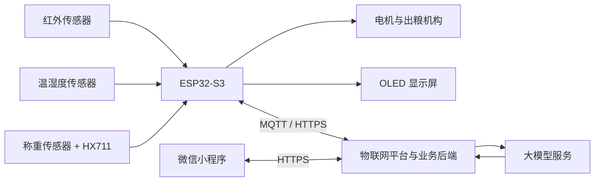

# AI Feeder

基于 ESP32-S3、微信小程序和大模型数据分析的智能宠物喂食器毕业设计。

> 当前仓库处于需求与架构规划阶段，尚未开始功能代码开发。

## 项目目标

- 通过微信小程序查看设备状态并远程控制出粮。
- 按设定时间和克数自动出粮。
- 使用红外传感器统计有效进食次数。
- 采集环境温度与湿度。
- 通过称重传感器测量余粮，并在 OLED 上显示。
- 将设备数据发送到服务端，由大模型生成趋势分析和喂养建议，再展示到小程序。

## 系统组成



## 功能范围

| 模块 | 规划功能 |
| --- | --- |
| 设备控制 | 手动出粮、定时定量出粮、执行结果反馈 |
| 进食检测 | 红外触发、去抖、有效进食事件计数 |
| 环境检测 | 温度、湿度采集与异常提示 |
| 余粮检测 | HX711 称重、克数与百分比换算 |
| 本地显示 | 余粮、温湿度、今日次数、网络状态 |
| 微信小程序 | 状态查看、远程控制、计划管理、历史记录 |
| 数据分析 | 日报、趋势、异常提醒和喂养建议 |

## 仓库规划

```text
AI_Feeder/
├── firmware/        ESP32-S3 固件
├── miniapp/         微信小程序
├── backend/         业务接口、数据存储与大模型调用
├── hardware/        BOM、接线、原理图和结构资料
├── docs/            需求、架构、协议和开发路线
└── tests/           功能、精度和可靠性测试
```

## 文档

- [需求说明](docs/requirements.md)
- [系统架构](docs/architecture.md)
- [通信与数据协议](docs/protocol.md)
- [开发路线图](docs/roadmap.md)
- [硬件规划](hardware/README.md)
- [固件规划](firmware/README.md)
- [小程序规划](miniapp/README.md)
- [后端规划](backend/README.md)

## 与原项目的关系

本项目与 [SmartPetFeeder](https://github.com/Plutov23/SmartPetFeeder) 分开维护。

- 原项目：STM32F103、ESP-01S、MaixCam、OneNET。
- 本项目：ESP32-S3、红外进食检测、独立后端、大模型数据分析。
- 原项目仅作为功能和实现经验参考，不与本项目共享发布版本。

## 当前状态

- [x] 建立独立仓库
- [x] 确定功能范围
- [x] 建立初始架构与协议文档
- [ ] 确定具体硬件型号和引脚
- [ ] 创建 ESP-IDF 工程
- [ ] 创建微信小程序工程
- [ ] 创建后端工程
- [ ] 完成整机联调

## 安全说明

- 大模型 API 密钥、物联网平台密钥和设备密钥不得写入固件或小程序仓库。
- 小程序通过业务后端访问设备，不直接保存高权限平台凭据。
- 电机使用独立供电并与 ESP32-S3 共地。
- 大模型输出只用于数据趋势和喂养建议，不作为医疗诊断依据。
