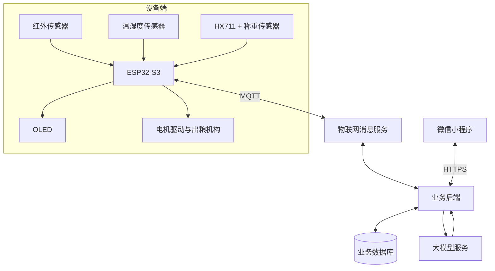

# 系统架构

## 1. 总体架构



## 2. 设计原则

- 基础喂食不依赖大模型。
- 定时计划以设备端可离线执行为目标。
- 小程序不直接持有设备平台高权限凭据。
- 控制命令必须有唯一编号和执行反馈。
- 原始数据、统计数据和 AI 结果分开保存。
- 未确认的硬件型号、GPIO 和云平台不在文档中写死。

## 3. 设备端职责

ESP32-S3 负责：

- Wi-Fi 和云端连接。
- 传感器采集。
- OLED 刷新。
- 电机控制。
- 本地定时计划。
- 进食事件状态机。
- NVS 参数持久化。
- 数据上报和命令执行反馈。

建议任务划分：

| 任务 | 主要职责 |
| --- | --- |
| sensor_task | 温湿度、重量和红外输入 |
| feeder_task | 电机控制和出粮状态机 |
| schedule_task | 校时和计划检查 |
| display_task | OLED 页面刷新 |
| cloud_task | MQTT 连接、订阅和上报 |
| storage_task | 计划、校准参数和计数持久化 |

具体周期和优先级在硬件验证后确定。

## 4. 服务端职责

- 微信用户身份验证。
- 设备绑定和访问控制。
- 下发控制命令。
- 接收并保存设备数据。
- 保存命令执行状态。
- 汇总日、周统计。
- 调用大模型并校验结构化结果。
- 为小程序提供统一 HTTPS API。

## 5. 大模型边界

大模型不直接控制电机，不生成设备底层命令。

允许输入：

- 每日喂食次数和克数。
- 进食次数、时长和消耗量。
- 温湿度统计。
- 余粮变化。
- 已确认的宠物基础信息。

允许输出：

- 数据摘要。
- 趋势描述。
- 异常提示。
- 非医疗性质的喂养建议。

模型失败、超时或输出格式错误时，服务端返回最近一次有效结果或明确的不可用状态。

## 6. 关键数据流

### 手动出粮

```text
小程序提交请求
→ 后端验证身份、设备归属、克数和频率
→ 生成 command_id
→ MQTT 下发
→ ESP32-S3 执行
→ 设备上报执行结果
→ 后端保存状态
→ 小程序查询或接收最新状态
```

### 定时出粮

```text
小程序保存计划
→ 后端保存
→ 同步到 ESP32-S3
→ 设备写入 NVS
→ 到点本地执行
→ 上报实际执行结果
```

### AI 分析

```text
设备上报原始数据
→ 后端生成日统计
→ 规则检查和数据清洗
→ 调用大模型
→ 保存结构化分析结果
→ 小程序展示
```

## 7. 故障降级

| 故障 | 预期行为 |
| --- | --- |
| Wi-Fi 断开 | 本地定时计划继续运行，数据等待后续补传 |
| 服务端不可用 | 手动远程控制不可用，本地功能继续 |
| 大模型不可用 | 不影响出粮，显示分析暂不可用 |
| 温湿度传感器异常 | 显示故障状态，停止上传该项有效值 |
| HX711 异常 | 禁止依赖重量的自动判断，并提示检查 |
| 红外传感器异常 | 停止增加进食次数，保留其他功能 |
